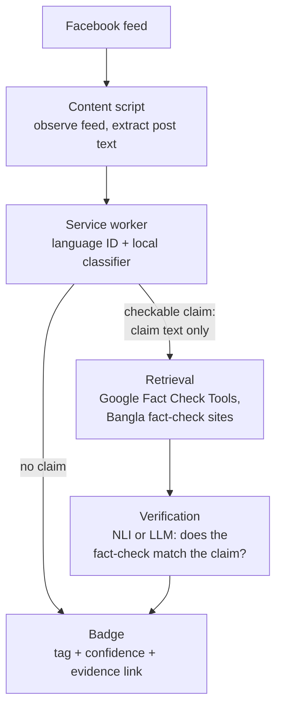

<div align="center">

# Jachai · যাচাই

### Tags and evidence for Facebook posts. Not verdicts.

A Chrome extension that adds a small badge to each post, in **Bangla**, **English**, and **Banglish**.


**Early stage: scaffold only, nothing implemented yet.**

[What it is](#what-jachai-is-and-is-not) ·
[Motivation](#motivation) ·
[Badges](#badges) ·
[How it works](#how-it-works) ·
[Evaluation](#evaluation-plan) ·
[Privacy](#privacy-design) ·
[Roadmap](#roadmap)

</div>

---

## What Jachai is (and is not)

Jachai runs while you browse Facebook. For each post it asks one question: *does this make a claim someone could check?* If so, it looks for a published fact-check that matches, and shows a badge with what it found and a link to the evidence.

| Jachai **is** | Jachai **is not** |
| --- | --- |
| A tag-and-evidence tool | A "fake" / "not fake" classifier |
| Points to existing fact-checks the reader can open | Stamps posts with its own verdict |
| Honest about "I found nothing" (`Unverified`) | Treats "no fact-check found" as "false" |
| Tuned for precision, because false flags are the costly error | Tuned for catching everything |

Why no verdict? Three reasons:

- **A verdict I can't back up is worse than no verdict.** A wrong "fake" lands on a real person's post and burns the user's trust in the tool.
- **Most posts can't be settled from their text alone.** Truth depends on the world, not on how a sentence is written. A model that scores "fakeness" from style mostly learns the style of its training sources.
- **Evidence is something a reader can check.** A link to a fact-check lets the reader judge. A bare confidence score doesn't.

## Motivation

Plenty of fake-news classifiers report high accuracy on a public dataset. I expect them to fall apart on a real Facebook feed, and I want to measure that instead of assuming it.

| Problem | Why it hurts |
| --- | --- |
| 🔀 **Domain shift** | Public datasets are mostly news articles or political statements. A feed is shares, memes, rants, ads, and screenshots. |
| ✂️ **Short, informal text** | Many posts are a line or two with slang, emoji, and no punctuation. Models trained on articles lean on structure that isn't there. |
| 🔤 **Banglish** | Bangla written in Latin script (*"ei khobor ta shotti?"*) breaks tokenizers and pretrained models, and there is little labeled data for it. |
| 🖼️ **Image-heavy posts** | Often the claim is in the image, not the caption. A text-only system sees almost nothing. This is a known gap. |
| 💔 **Unbacked "fake" labels** | One confident wrong flag teaches users to ignore the tool. That is why precision comes first. |

## Badges

Every badge carries a confidence value and, where relevant, an evidence link. None of them is a truth verdict.

| Badge | Meaning | When it appears |
| --- | --- | --- |
| 🔎 `Checkable claim` | The post makes a factual claim that could be verified against a source. | The in-browser classifier finds a verifiable claim. Opinions, jokes, greetings, and personal updates should not get this. |
| ✅ `Matches fact-check` | The claim closely matches one a fact-checking organization has already reviewed. **The link to that review is shown.** | Retrieval finds a candidate, and the verification step (NLI or LLM) agrees the match is real. The badge shows the source, not my own verdict. |
| ⚡ `Clickbait / sensational` | The wording is built to provoke a reaction, whether or not the content is true. | The in-browser classifier flags the style. This is about phrasing, not accuracy. |
| ❔ `Unverified` | A checkable claim, but no matching fact-check was found. | A claim was detected and retrieval returned nothing that passed verification. This does **not** mean the claim is false. Often nobody has checked it. |
| 🤖 `Possibly AI-written` *(optional, off by default)* | The text has features associated with machine-generated writing. Low confidence. | Only when the user turns it on. This signal is weak, especially in Bangla. See [limitations](#limitations-and-risks). |

## How it works

For each post:

1. **Language ID.** Bangla, English, or Banglish.
2. **Cheap in-browser classifier.** Is there a checkable claim? Is it clickbait? Runs locally.
3. **Retrieval.** For claims only: search the Google Fact Check Tools API, plus Bangla fact-check sites where their terms permit.
4. **Verification.** NLI or an LLM judges whether a retrieved fact-check really covers the claim, rather than just sharing keywords.
5. **Badge.** A tag with a confidence value and an evidence link.



Badges that depend only on the local classifier (`Checkable claim`, `Clickbait / sensational`) never touch the network.

## Planned tech stack

> Everything here is **planned, not final**.

| Layer | Plan |
| --- | --- |
| Extension | TypeScript, Vite, Manifest V3 |
| In-browser inference | ONNX Runtime Web or transformers.js |
| ML / training | Python 3.11+, Hugging Face transformers, ONNX export |
| Models to compare | BanglaBERT and XLM-R (fine-tuned), zero-shot LLM, retrieval + NLI |
| Backend (optional) | Stateless FastAPI service |

## Repository structure

```
jachai/
├── extension/
│   ├── src/
│   │   ├── content/        feed observer, post extraction, badge injection
│   │   ├── background/     service worker: model loading, messaging, caching
│   │   └── ui/             badge component, popup/options page
│   └── public/             icons, static assets
├── ml/
│   ├── data/
│   │   ├── raw/            downloaded public datasets (git-ignored)
│   │   ├── processed/      cleaned and split data (git-ignored)
│   │   └── labeled/        hand-labeled real-feed eval set (local only)
│   ├── notebooks/          exploration
│   ├── src/                training, eval, ONNX export
│   └── eval/               eval harness + results
├── backend/                optional stateless FastAPI service
│   ├── app/
│   └── tests/
├── docs/
│   ├── architecture.md
│   ├── datasets.md
│   ├── evaluation.md
│   ├── privacy.md
│   ├── labeling-guide.md
│   └── roadmap.md
├── .env.example            variable names only
└── README.md
```

## Datasets

Candidates, not commitments. I haven't verified licenses or current availability for any of them, and I'll do that before using anything. No sizes are listed because I haven't checked them.

| Dataset | Notes |
| --- | --- |
| **LIAR** | English short political statements with fact-check-based labels. Short text is useful, but the domain is political speech, not social posts. |
| **FakeNewsNet** | English news and social context collected around fact-checking sources. Availability depends on re-collecting content, which may be incomplete. |
| **ISOT** | English news articles labeled by source. ⚠️ **Known to be trivially separable by source style**, so a high score on it says very little. At most a cautionary baseline. |
| **BanFakeNews** | Bangla news dataset. Probably the closest public starting point for Bangla, but it is news text, not social posts. |

The dataset that matters most is the one I build myself: roughly 200-300 real posts, hand-labeled, kept local and never published. Rules will live in [`docs/labeling-guide.md`](docs/labeling-guide.md).

## Evaluation plan

<table>
<tr>
<td width="33%" valign="top">

**🎯 Real-feed set**

About 200-300 hand-labeled posts across Bangla, English, and Banglish. Stays on my machine.

</td>
<td width="33%" valign="top">

**📏 Metrics**

Precision first, then recall and F1. Everything broken down per language.

</td>
<td width="33%" valign="top">

**📉 Public vs. real**

Measure the drop for the same model between a public dataset and the real-feed set.

</td>
</tr>
</table>

### Model comparison

Every result is **TBD**.

| Approach | Precision | Recall | F1 | Notes |
| --- | :---: | :---: | :---: | --- |
| Fine-tuned BanglaBERT | TBD | TBD | TBD | TBD |
| Fine-tuned XLM-R | TBD | TBD | TBD | TBD |
| Zero-shot LLM | TBD | TBD | TBD | TBD |
| Retrieval + NLI | TBD | TBD | TBD | TBD |

### Public vs. real-feed drop

| Setting | Result |
| --- | :---: |
| Best model on public dataset | TBD |
| Same model on real-feed set | TBD |
| Drop | TBD |

## Privacy design

| Principle | What it means |
| --- | --- |
| 🧠 **In-browser inference** | Language ID and the first-stage classifier run locally. Posts with no checkable claim never leave the browser. |
| 🚫 **No feed upload** | The feed, page HTML, and post lists are never sent anywhere. |
| ✂️ **Claim text only** | When the network is needed, only the extracted claim text goes out. No author names, profile links, or post URLs. |
| 🗑️ **No profile data stored** | Author names and profile data aren't stored, locally or on a backend. |
| ✋ **Saving is opt-in** | A post enters the labeled set only when I save it on purpose. The file stays local and git-ignored. |

The backend, if I build it, is stateless. Details will go in [`docs/privacy.md`](docs/privacy.md).

## Limitations and risks

- **Facebook DOM brittleness.** The markup is obfuscated and changes often. All selectors will live in a single file so a break is a one-file fix, but breaks will happen.
- **Meta's terms of service.** Annotating a page you're already viewing is different from scraping, but I haven't concluded it's within Meta's terms. I'll read them closely and keep the tool to what the logged-in user already sees.
- **AI-text detection is weak.** Detectors are unreliable in English and worse in Bangla, with little training data. Hence optional, off by default, low confidence.
- **Fact-check coverage gaps in Bangla.** Far fewer Bangla claims have published fact-checks than English ones. Many real claims will end up `Unverified` simply because nobody has reviewed them.
- **Text only.** Claims carried in images or video are mostly invisible to this design.
- **Banglish.** Romanized Bangla has no standard spelling, which makes language ID and classification harder.
- **No Chrome Web Store release planned.** This is a portfolio and research project. If you want to try it, you'll load it unpacked.

## Roadmap

Four weeks. More detail in [`docs/roadmap.md`](docs/roadmap.md).

- [ ] **Week 1: skeleton.** Extension scaffold, feed observer, post extraction, badge injection with hardcoded tags.
- [ ] **Week 2: labeling and baseline.** Build the real-feed labeled set, train a first baseline, measure it on public data and on the real set.
- [ ] **Week 3: retrieval and verification.** Fact-check retrieval, NLI / LLM verification, evidence links on badges.
- [ ] **Week 4: evals, writeup, demo.** Model comparison, public-vs-real analysis, real numbers in this README, demo video.

## Getting started

**Not available yet.**

<!-- TBD: build instructions -->
<!-- TBD: load unpacked in chrome://extensions -->
<!-- TBD: configure .env (see .env.example) -->

Unpacked-install steps will go here once there is something to install.

## Contributing

Nothing to contribute to yet. Once the skeleton is in place I'll document how to file issues and what kind of help is useful. The most valuable contribution later is likely to be Bangla and Banglish labeling feedback.

## About the name

**যাচাই** (*jachai*) is Bangla for "verify" or "check". It's the verb you'd use for checking a claim before believing it, which is what I want this tool to nudge people toward.
