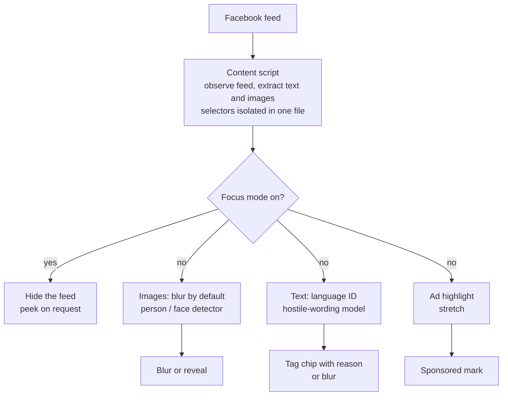

<div align="center">

# Jachai · যাচাই

### A local-first companion for your Facebook feed.

Blur people, hide the feed, highlight ads, and tag hostile wording, in **Bangla**, **English**, and **Banglish**. Everything runs in the browser.


**Early stage: scaffold only, nothing implemented yet.**

[What it is](#what-jachai-is-and-is-not) ·
[Features](#features) ·
[How it works](#how-it-works) ·
[Evaluation](#evaluation-plan) ·
[Privacy](#privacy-design) ·
[Limitations](#limitations-and-risks) ·
[Roadmap](#roadmap)

</div>

---

## What Jachai is (and is not)

Jachai is a Chrome extension (Manifest V3) that I'm building to make my own time on Facebook better. It filters what I'd rather not see, and it says why. All of it runs on my device with models bundled in the extension. There is no backend, no search service, and nothing to pay for at runtime.

It started as a fake-news checker. I dropped that: it needs live fact-check lookups, which cost money and depend on sources that may not cover Bangla, and a text-only model can't tell whether a claim is true. What I kept are things a small local model can do honestly.

| Jachai **is** | Jachai **is not** |
| --- | --- |
| A personal filter that blurs, hides, or tags things | A "fake" / "not fake" classifier |
| Describes the *wording* of a post ("threat wording") | A judge of people or of what's true |
| Reversible: blurred things can always be revealed | A tool that deletes or reports anything |
| Local: nothing leaves the browser | A service that uploads the feed |

Because it is a personal tool, a missed post costs me more than a wrongly blurred one, since I can always click to reveal. I still measure both kinds of error, and I report them.

## Features

| Feature | What it does | Status |
| --- | --- | --- |
| 🫥 **Blur people** | Detects images that contain people (or faces) and blurs them until I choose to reveal. | Planned, core |
| 🎯 **Focus mode** | Hides the feed with one toggle, with an option to peek. No model needed. | Planned, core |
| 🏷️ **Hostile-wording tags** | Tags posts whose wording is threatening, insulting, demeaning to a group, or accusing. | Planned, core |
| 📢 **Ad highlight** | Marks sponsored posts. | Stretch goal |

### Blur people

Three levels, from reliable to risky:

1. **Any image containing a person.** Person detection is a mature task and runs in the browser. This is the main feature.
2. **Faces only.** Also reliable, but it misses people shown from behind or in groups.
3. **Only people read as women (experimental, off by default).** This needs a model to guess gender from appearance, which is the weakest and most biased part. A published audit of commercial systems found error rates up to 34.7% for darker-skinned women, against 0.8% for lighter-skinned men ([Gender Shades](https://proceedings.mlr.press/v81/buolamwini18a.html)). That was a different setting and older systems, but it tells me skin tone and image quality will affect any result. If I build this, I will measure its error rate and publish it.

Images start blurred and are revealed once the check clears them, so a slow model never shows a raw image first. Video is checked on sampled frames.

### Hostile-wording tags

A post can carry several tags. No tag means neutral.

| Tag | Meaning | Not this |
| --- | --- | --- |
| **Threat** | Says or wishes that someone should be hurt or killed. | News reporting a threat, quotes, jokes like "I'd kill for biryani". |
| **Personal attack** | Insults, slurs, or degrading mockery aimed at an individual. | Plain disagreement. |
| **Group hate** | Demeans a whole group by identity. Optional target: gender, politics, origin, other. | Criticizing a policy or an act. |
| **Accusation** | Claims a person or group did something wrong, usually without proof. | Not hostile on its own. A post can be both an accusation and a threat. |

"Man-hating" and "woman-hating" posts are Group hate with a gender target, not separate classes. I'm deliberately not tagging religion as a topic. Hate aimed at a religion would show up as Group hate.

The tag names describe the text. They don't call anyone a bigot, and they don't say "this is hate speech" as a verdict.

I'll start with one binary "hostile wording" detector and split it into the four types only if the data supports it. Details are in [`docs/labeling-guide.md`](docs/labeling-guide.md).

### Ad highlight (stretch)

Facebook scrambles its "Sponsored" label in the page markup, so simple selectors fail and small open-source workarounds break when the page changes ([write-up](https://www.dylanpaulus.com/how-fb-avoids-adblockers/)). I'll try it only if time is left, and I'll treat it as a constant game of catch-up.

## How it works

1. A content script watches the feed and extracts post text and image references. All Facebook selectors live in one file.
2. Images are blurred by default and sent to a person detector running in the browser.
3. Post text goes through language ID (Bangla, English, Banglish) and then the hostile-wording model.
4. Each result becomes a blur, a tag chip with a short reason, or a highlight. A click reveals the original.
5. Options let me switch each feature and each tag on or off and set a sensitivity level.



Everything in the diagram runs inside the extension. After the models are bundled or downloaded once, no network is needed.

## Planned tech stack

> Everything here is **planned, not final**.

| Layer | Plan |
| --- | --- |
| Extension | TypeScript, Vite, Manifest V3 |
| In-browser inference | ONNX Runtime Web, transformers.js, or MediaPipe tasks for vision. Probably hosted in an offscreen document rather than the service worker. |
| Image models | Off-the-shelf person and face detectors (MediaPipe's object detector is the first candidate) |
| Text models | BanglaBERT and XLM-R (fine-tuned, then quantized), plus lighter baselines |
| Training | Python 3.11+, Hugging Face transformers, ONNX export |

## Repository structure

```
jachai/
├── extension/
│   ├── src/
│   │   ├── content/        feed observer, post extraction, blur and tag injection
│   │   ├── background/     service worker: model loading, messaging, caching
│   │   └── ui/             tag chips, popup and options page
│   └── public/             icons, static assets
├── ml/
│   ├── data/
│   │   ├── raw/            downloaded public datasets (git-ignored)
│   │   ├── processed/      cleaned and split data (git-ignored)
│   │   └── labeled/        hand-labeled real-feed eval set (local only)
│   ├── notebooks/          exploration
│   ├── src/                training, eval, ONNX export
│   └── eval/               eval harness + results
├── backend/                empty and unused in the current plan (no server)
├── docs/
│   ├── prd.md              requirements and due diligence
│   ├── architecture.md
│   ├── datasets.md
│   ├── evaluation.md
│   ├── privacy.md
│   ├── labeling-guide.md
│   └── roadmap.md
├── .env.example            leftover from the earlier design
└── README.md
```

## Datasets

Candidates, not commitments. I haven't verified licenses or download availability for any of them, and I'll do that before using anything. Counts are as reported in the cited papers or pages.

| Dataset | What it is | Notes |
| --- | --- | --- |
| [BanTH](https://arxiv.org/pdf/2410.13281) | 37,350 YouTube comments in transliterated Bangla (Banglish), labeled hate or not, with targets such as political, gender, personal offense, abusive/violence, origin | The only Banglish set I found. The paper's best multi-label Macro-F1 was 30.17%, so the task is hard. |
| [Bengali Hate Speech Dataset](https://www.github.com/rezacsedu/Bengali-Hate-Speech-Dataset) | About 8,087 posts from Facebook, YouTube and newspapers (per a 2026 survey) | Categories: political, personal, geopolitical, religious. |
| [Bangla multilabel cyberbully / threat set](https://data.mendeley.com/datasets/sz5558wrd4/3) | 12,557 Facebook and TikTok comments | Has threat and harassment labels. |
| [Facebook cyberbullying study](https://arxiv.org/pdf/2106.04506) | 44,001 Facebook comments | Classes include threat, troll, religious, sexual, not bully. |
| [BanHate](https://aclanthology.org/2025.banglalp-1.19) | 19,203 YouTube comments | Hate speech benchmark. |
| [TRAC 2020](https://arxiv.org/pdf/2003.07428), [OMANISHA](https://data.mendeley.com/datasets/x9fym689h4) | Misogyny and aggression in Bangla | I found no dataset for hostility toward men. |
| [Hateful Memes, MMHS150K](https://arxiv.org/pdf/2411.19017), Bangla meme sets | Meme datasets | Possible later extension to images with text. |

All of these are comments or tweets, not Facebook posts, and I found no large public set of Facebook posts. That is why the hand-labeled set matters. It stays on my machine, and the labeling rules are in [`docs/labeling-guide.md`](docs/labeling-guide.md).

## Evaluation plan

<table>
<tr>
<td width="33%" valign="top">

**🎯 Real-feed set**

Hand-labeled real posts (about 200-300) and images, across Bangla, English, and Banglish. Stays local.

</td>
<td width="33%" valign="top">

**📏 Metrics**

Precision and recall for every tag, per language. Plus "wrongly blurred" and "missed" per 100 posts, because that is what I actually feel when using it.

</td>
<td width="33%" valign="top">

**📉 Public vs. real**

Measure the drop for the same model between a public dataset and my real-feed set.

</td>
</tr>
</table>

Published scores are usually measured on data like the training data. Related tasks show big drops elsewhere: one fake-news model went from about 99.85% to about 68% on other datasets ([study](https://jaes.qu.edu.sa/index.php/jae/article/view/2733)), and an SMS spam model's recall fell from 99.03% to under 80% on newer messages ([study](https://arxiv.org/pdf/2504.09776)). I expect something similar here, and I want the number.

### Hostile-wording models

All results are **TBD**.

| Approach | Precision | Recall | F1 | Notes |
| --- | :---: | :---: | :---: | --- |
| Lightweight baseline (TF-IDF + linear) | TBD | TBD | TBD | TBD |
| Fine-tuned BanglaBERT | TBD | TBD | TBD | TBD |
| Fine-tuned XLM-R | TBD | TBD | TBD | TBD |

### Public vs. real-feed drop

| Setting | Result |
| --- | :---: |
| Best model on public dataset | TBD |
| Same model on real-feed set | TBD |
| Drop | TBD |

### Other features

| Feature | Measure | Result |
| --- | :---: | :---: |
| Blur people: person present | Precision, recall on hand-labeled images | TBD |
| Blur people: women-only mode (experimental) | Error rate, reported separately | TBD |
| Ad highlight (if built) | Share of sponsored posts caught, false highlights | TBD |

## Privacy design

| Principle | What it means |
| --- | --- |
| 🧠 **Everything local** | Text and images are processed in the browser. There is no server and nothing is uploaded. |
| 🚫 **No feed upload** | The feed, page HTML, and post lists never leave the device. |
| 🗑️ **No profile data stored** | Author names and profile data aren't stored. |
| ✋ **Saving is opt-in** | A post or image enters the labeled set only when I save it on purpose. The file stays local and git-ignored. |
| 👀 **Reversible** | Nothing is deleted or reported. Blurred items can be revealed. |

Details are in [`docs/privacy.md`](docs/privacy.md).

## Limitations and risks

- **Facebook DOM brittleness.** The markup is obfuscated and changes often. All selectors live in one file so a break is a one-file fix, but breaks will happen. Ad highlighting is the most fragile feature.
- **Meta's terms of service.** Meta's terms say you may not "access or collect data from our Products using automated means (without our prior permission)". A content script that reads my own feed locally is a gray area, so I'll test with a non-primary account and I won't claim it is allowed.
- **Gender-from-appearance is error-prone.** The women-only blur is experimental because its errors are likely to be uneven across skin tones and photo quality.
- **Text models read wording, not intent.** Quotes, news reports, sarcasm, counter-speech and Banglish spelling variants will cause errors. Published accuracy in this area varies a lot (the best multi-label Macro-F1 in the BanTH paper was 30.17%).
- **Little data for threats and for Banglish.** Threats are rare in a normal feed, and I found no dataset on hostility toward men.
- **Different domain.** Every public dataset above is comments or tweets, not posts.
- **Pixel access.** Reading images that Facebook serves from another domain may need extra work in an extension. This is an open technical risk.
- **Model size.** BanglaBERT has about 110M parameters, so it likely needs quantizing or a smaller model to run comfortably in a browser.
- **No Chrome Web Store release planned.** This is a personal and portfolio project. You'd load it unpacked.

## Roadmap

Four weeks. More detail in [`docs/roadmap.md`](docs/roadmap.md) and the requirements in [`docs/prd.md`](docs/prd.md).

- [ ] **Week 0: de-risk.** Confirm the browser can read feed images and run a person detector. Check how Facebook marks sponsored posts today. Verify dataset licenses.
- [ ] **Week 1: skeleton.** Extension scaffold, feed observer, one selector file, focus mode working, blur-all placeholder, hardcoded tag chips.
- [ ] **Week 2: blur and labeling.** Blur people with an off-the-shelf detector. Pilot-label about 50 posts with two or three people. Train a first hostile-wording baseline on public data.
- [ ] **Week 3: real-feed eval.** Label more, measure the baseline and fine-tuned models on the real set. Split into types if the data supports it. Ad highlight if time allows.
- [ ] **Week 4: write-up.** Public-vs-real analysis, real numbers in this README, demo video.

## Getting started

**Not available yet.**

<!-- TBD: build instructions -->
<!-- TBD: load unpacked in chrome://extensions -->

Unpacked-install steps will go here once there is something to install.

## Contributing

Nothing to contribute to yet. Once the skeleton is in place I'll document how to file issues. The most valuable contribution later will be Bangla and Banglish labeling feedback.

## About the name

**যাচাই** (*jachai*) is Bangla for "verify" or "check". The name comes from the original fact-checking idea, and I may rename the project now that its scope has changed. I also haven't checked whether another project already uses the name.
